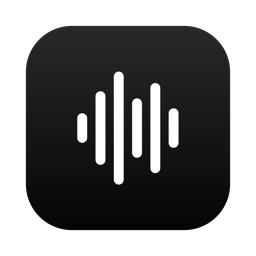
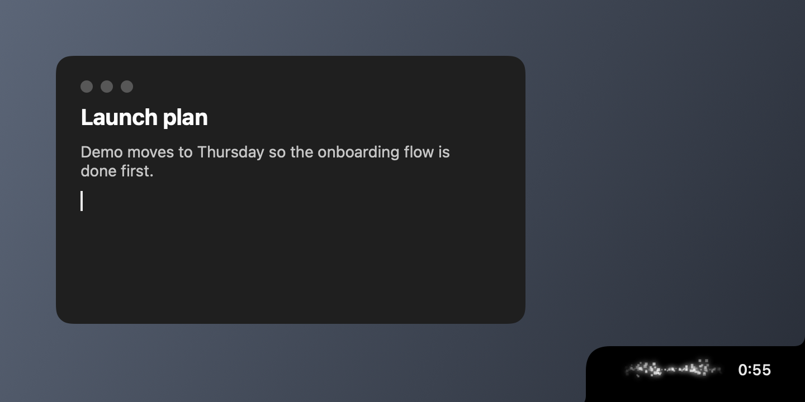
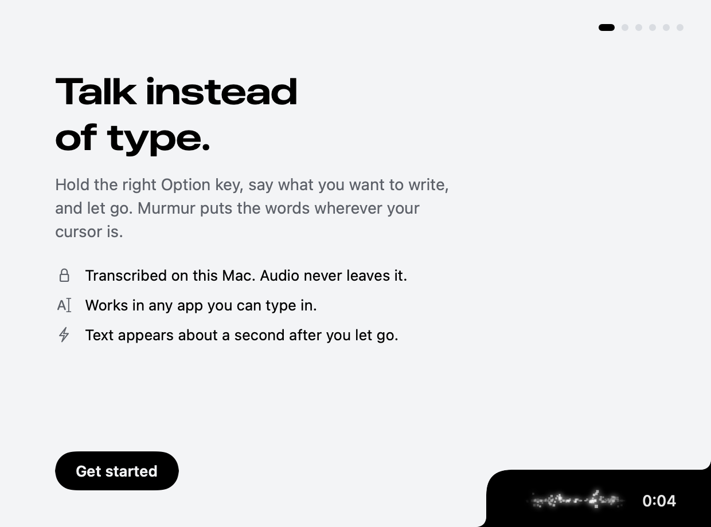
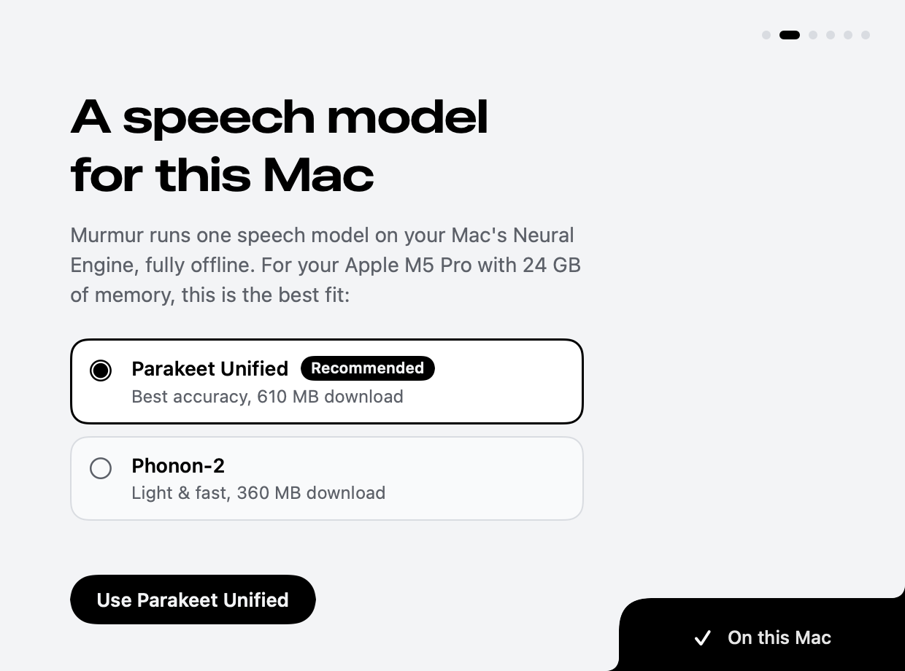
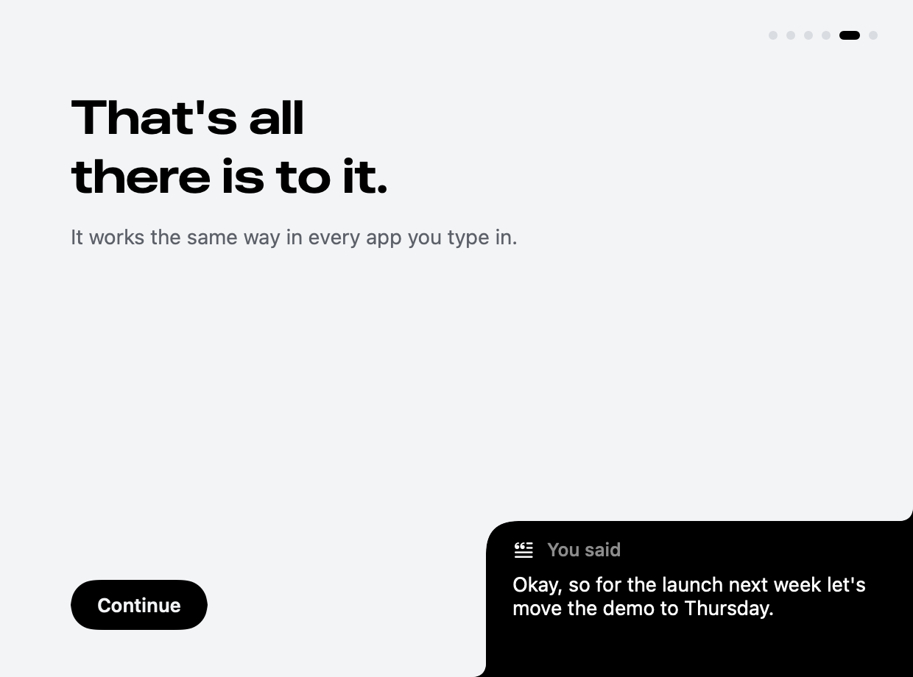
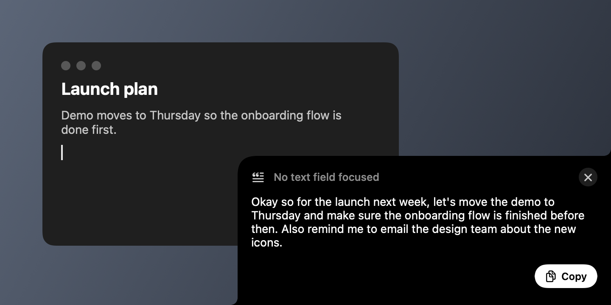

<p align="center">
  
</p>

<h1 align="center">Murmur</h1>

<p align="center">
  Hold a key, say it, let go. Your words appear wherever you're typing.<br>
  Speech is transcribed on your Mac by NVIDIA Parakeet. Nothing goes to the cloud.
</p>

<p align="center">
  <a href="https://github.com/mason50x/murmur/releases/latest"></a>
  
  
  <a href="LICENSE"></a>
</p>

<p align="center">
  
</p>

## Install

Paste this into Terminal:

```sh
curl -fsSL https://raw.githubusercontent.com/mason50x/murmur/main/install.sh | bash
```

The [installer](install.sh) downloads the latest release, checks its SHA-256 and that it's signed with
Murmur's release certificate, installs it to `/Applications` (asking for your password only if that
folder isn't writable), and opens it. A short setup guide takes it from there.

Needs macOS 26 or later on Apple silicon, and about 1 GB of free space for the speech model.

<details>
<summary>Read the script first, or install by hand</summary>

```sh
curl -fsSLO https://raw.githubusercontent.com/mason50x/murmur/main/install.sh
less install.sh
bash install.sh
```

By hand: download `Murmur.zip` from [Releases](https://github.com/mason50x/murmur/releases/latest),
unzip it, move `Murmur.app` to Applications, then run

```sh
xattr -dr com.apple.quarantine /Applications/Murmur.app
```

Murmur isn't notarized by Apple (that needs a paid developer account), so without that line macOS
refuses to open a copy downloaded through a browser. See [Security](#security) for what vouches for
the app instead.
</details>

## Setup

The first launch walks you through four short steps: picking a speech model for your Mac,
microphone access, Accessibility access, and one practice dictation. The model downloads in the
background while you go, and Murmur doesn't ask for any permission before explaining what it's for.

<p align="center">
  <picture>
    <source media="(prefers-color-scheme: dark)" srcset="docs/images/onboarding-welcome-dark.png">
    
  </picture>
  <picture>
    <source media="(prefers-color-scheme: dark)" srcset="docs/images/onboarding-model-dark.png">
    
  </picture>
  <picture>
    <source media="(prefers-color-scheme: dark)" srcset="docs/images/onboarding-practice-dark.png">
    
  </picture>
</p>

## Use

| | |
|---|---|
| Hold **right ⌥** | Record; let go to transcribe and insert |
| Double-tap **right ⌥** | Hands-free (the center line goes solid); tap once to stop |
| **Esc** | Cancel recording, or dismiss the copy card |
| **⌃⌘V** | Paste the last transcript again |

Where the text goes:

- A text field has focus: it's pasted, and your clipboard is put back afterwards.
- Something else has focus (a web page, the desktop, a list): it's shown in the notch with a **Copy** button.
- The app doesn't say what has focus: it's pasted, and the card stays up a few seconds in case it missed.

<p align="center">
  
</p>

Formatting adapts to where you're typing. An empty field gets a capitalized, punctuated sentence;
words dropped mid-sentence are lowercased and spaced to fit. Longer dictations are laid out without
rewriting a word: say "first… second… third…" and you get a numbered list, pause between thoughts
and you get paragraphs, and a "Hey Sam," opener or "Thanks, Mason" sign-off gets a line of its own.
Say "new paragraph" or "new line" to break it yourself.

While you dictate, Murmur mutes your Mac's sound so music and videos don't talk over you, and
puts it back when you let go (turn this off in Settings). The menu bar icon has recent
transcripts, microphone selection, sounds, and Settings.

## Speech models

Murmur runs one English model on the Neural Engine, fully offline once downloaded. Setup recommends
one from your Mac's memory, and you can switch any time in Settings.

| Model | Recommended for | Download | Word error rate* |
|---|---|---|---|
| [Parakeet Unified 0.6B](https://huggingface.co/FluidInference/parakeet-unified-en-0.6b-coreml) | 16 GB of memory or more | 610 MB | 2.1% |
| [Phonon-2](https://huggingface.co/FluidInference/phonon-2-coreml) | 8 GB Macs, or a nearly full disk | 360 MB | 2.5% |

Both are 600M-parameter NVIDIA Parakeet models with punctuation and capitalization, run through
[FluidAudio](https://github.com/FluidInference/FluidAudio). Phonon-2 is Fermion Research's
quantization-aware retraining of Parakeet TDT v3: half the memory, and the fastest model on the
Neural Engine. A typical dictation is text in well under a second on either.

<sub>*LibriSpeech test-clean, from FluidAudio's benchmarks.</sub>

## Privacy

- **Audio stays on your Mac.** It's transcribed in memory and discarded.
- **Murmur only goes online for two things:** downloading the speech model from Hugging Face, and
  checking GitHub for updates. There are no analytics, accounts, or telemetry.
- **What's kept on disk:** your last 50 transcripts (turn this off or clear it in Settings), and a
  log of events with character counts, never what you said. Keeping the last recording for
  troubleshooting is off unless you turn it on.
- **Microphone** access is used only while you hold the key. **Accessibility** access lets Murmur
  notice the right Option key from any app, read the text around your cursor so punctuation fits,
  and paste.

## Updates

Murmur checks for updates once a day and puts **Update to Murmur x.y.z…** in its menu when one is
out, without interrupting you mid-dictation. Choose **Check for Updates…** to look now. Updates are
installed by [Sparkle](https://sparkle-project.org) and verified against Murmur's signing key first.

## Security

Murmur isn't notarized, so instead of Apple vouching for it:

- Every update is signed with an Ed25519 key that only the maintainer holds. The app refuses any
  update, or any update feed, without a valid signature.
- Every release is code-signed with the same Murmur certificate, which the installer checks before
  installing. Because the signature is stable, macOS keeps your permissions across updates.
- The app runs with the hardened runtime, and release builds ignore `murmur://` links.

[SECURITY.md](SECURITY.md) has the details and how to report a vulnerability privately.

## Uninstall

```sh
curl -fsSL https://raw.githubusercontent.com/mason50x/murmur/main/install.sh | bash -s -- --uninstall
```

This removes the app, its speech models, history, logs, settings, and its microphone and
Accessibility permissions.

## Build from source

Requires macOS 26+, Apple silicon, and the Xcode Command Line Tools (`xcode-select --install`;
full Xcode isn't needed).

```sh
git clone https://github.com/mason50x/murmur && cd murmur
make
```

`make` builds a development copy, installs it over your Murmur, and opens it. The first run also
creates a local signing certificate so macOS keeps its permissions across rebuilds. `make test`
runs the unit tests and `make help` lists everything else.

Development builds include hooks that release builds leave out:

- `open -g "murmur://preview?state=recording|locked|transcribing|result|pasted|message|loading|idle"` shows a notch state
- `open -g "murmur://simulate?path=/abs/file.wav"` runs a file through the full pipeline as if spoken
- `open -g "murmur://mictest?seconds=3"` records, transcribes, and logs (no UI, no paste)
- `open -g "murmur://onboarding"` opens the setup guide
- `build/Murmur.app/Contents/MacOS/Murmur --render-ui dir/` renders onboarding, Settings, and notch states to PNGs

Any build can run `Murmur.app/Contents/MacOS/Murmur --transcribe file.wav [--model unified|phonon2]`
for a headless check. The log is at `~/Library/Logs/Murmur.log`.

```
Sources/Murmur/
  MurmurApp.swift       entry point, menu bar, CLI
  AppController.swift   state machine: idle → recording → transcribing → paste / copy card
  ModelCatalog.swift    the speech models and which one suits this Mac
  Transcriber.swift     Parakeet Unified / Phonon-2 via FluidAudio
  AudioRecorder.swift   AVAudioEngine capture → 16 kHz mono, levels, input devices
  HotkeyMonitor.swift   right-⌥ hold / double-tap / Esc
  OutputMute.swift      mutes sound output while you dictate, restores it after
  TextInserter.swift    focus detection, clipboard-preserving paste
  SmartFormat.swift     casing, punctuation, and spacing from the text around the caret
  Layout.swift          paragraphs and lists from pauses and spoken ordinals
  Updater.swift         Sparkle updates, loaded only after its signature checks out
  SettingsView.swift    Settings window
  Onboarding/           first-run setup guide
  Notch/                corner panel, shape, Drift waveform, timer, copy card
```

### Releasing

```sh
make release                # patch: everything on main since the last release
make release BUMP=minor     # or major, or an exact version like BUMP=2.0.0
```

That's the whole process. It starts the Release workflow in GitHub Actions and follows it until
the release is out. The workflow turns the commits since the last tag into the CHANGELOG entry
(or uses a hand-written `## Unreleased` section if there is one), commits "Release X.Y.Z", builds
and signs the app and the update feed, tags it, and publishes the GitHub release. Installed
copies update through Sparkle within a day. `make release-dry-run` builds and signs a release
locally into `dist/` without publishing anything.

The release certificate and the Sparkle update key are kept in 1Password (*Murmur Release
Signing*) and as secrets of the repository's `production` environment, which only `main` can
use; `scripts/release-keys.sh github` re-syncs them. Every installed copy trusts exactly these
two keys, so don't rotate them: a new certificate makes macOS forget everyone's permissions, and
a new update key cuts existing installs off from updates. A fork runs
`scripts/release-keys.sh create` and `github` once to make its own.

## Credits

- [FluidAudio](https://github.com/FluidInference/FluidAudio) by FluidInference runs the models on the Neural Engine.
- [Parakeet](https://huggingface.co/nvidia/parakeet-unified-en-0.6b) by NVIDIA, and [Phonon-2](https://huggingface.co/FermionResearch/Phonon-2) by Fermion Research.
- [Sparkle](https://sparkle-project.org) handles updates.

Murmur is released under the [MIT License](LICENSE). Bundled and downloaded components keep their
own licenses; see [THIRD_PARTY_NOTICES.md](THIRD_PARTY_NOTICES.md).
